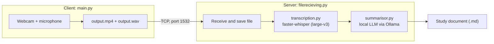

# Lesson Summariser
 
Lesson Summariser records a full class on one device, then transcribes and summarises it on a second, more powerful device. The result is a written study document that covers the whole lesson: the explanations, worked examples, key terms, homework and deadlines.
 
A student who misses a lesson, or who wants to revise it, can read the document instead of watching the recording.
 
## How it works
 
The project is split over **two devices** that talk to each other over a TCP connection:
 
| Device | Run this | Role |
|---|---|---|
| **Client** (e.g. a laptop in the classroom) | `python main.py` | Records video from the webcam and audio from the microphone, then sends the recording to the server |
| **Server** (a machine with an NVIDIA GPU) | `python filerecieving.py` | Receives the recording, transcribes the audio, and writes the summary |
 

 
1. **Record.** `main.py` opens the default webcam and microphone. Video is written to `output.mp4` (20 fps) and audio to `output.wav` (44.1 kHz, mono). Press **q** in the camera window to stop.
2. **Send.** When recording stops, the client connects to the server on port `1532` and sends the file.
3. **Receive.** `filerecieving.py` listens for connections, saves each file as `received<MM-DD-HH-MM-SS>.wav` (or `.mp4`), and starts transcription in a background thread so it can keep accepting new connections.
4. **Transcribe.** `transcription.py` runs [faster-whisper](https://github.com/SYSTRAN/faster-whisper) with the `large-v3` model on the GPU. The language is detected automatically. Every segment is stored with its start and end time.
5. **Summarise.** `summarisor.py` sends the transcript to a local LLM through [Ollama](https://ollama.com) with a detailed prompt, and saves the answer as a Markdown file.
## Project structure
 
| File | Purpose |
|---|---|
| `main.py` | **Client.** Captures video and audio, saves them, and sends the audio to the server |
| `filesending.py` | Client helper with `open_connection()` and `send_file()` |
| `filerecieving.py` | **Server.** Listens on port 1532, saves incoming files, and triggers transcription |
| `transcription.py` | Speech-to-text with faster-whisper; writes the transcript file |
| `summarisor.py` | Builds the prompt, calls the LLM through Ollama, and writes the summary |
 
## Requirements
 
**Both devices**
 
- Python 3.9 or newer
- A network connection between the two devices, with TCP port `1532` reachable on the server
**Client**
 
- A webcam and a microphone
- Python packages:
```bash
  pip install opencv-python sounddevice wavio numpy
```
 
**Server**
 
- An NVIDIA GPU with CUDA 12 (transcription is configured with `device="cuda"`)
- Linux (`transcription.py` preloads the NVIDIA libraries by looking for `.so` files)
- [Ollama](https://ollama.com) installed and running, with the model named in `summarisor.py` available (check with `ollama list`)
- Python packages:
```bash
  pip install faster-whisper ollama nvidia-cublas-cu12 "nvidia-cudnn-cu12==9.*"
```
 
## Setup
 
1. Copy the project folder to both devices. Each device only runs its own part, but the files import each other, so keeping the whole folder on both is simplest.
2. Find the server's IP address.
3. On the client, open `main.py` and set that address (line 48):
```python
   connection = filesending.open_connection("<server-ip>", 1532)
```
 
4. Make sure the server's firewall allows incoming connections on port `1532`.
5. Optional: to use a different LLM, change the `model` value in `summarisor.py`. To use a different Whisper size, change `model_size` in `transcription.py`.
## Usage
 
**1. Start the server** (on the GPU machine):
 
```bash
python filerecieving.py
```
 
It prints `Listening on port 1532` and waits.
 
**2. Start the client** (in the classroom):
 
```bash
python main.py
```
 
A camera window opens and recording begins. Leave it running for the whole lesson.
 
**3. Stop the recording.** Click the camera window and press **q**. The client saves `output.mp4` and `output.wav`, sends the audio to the server, and prints `done`.
 
**4. Wait for the server.** Its console shows the connection, the detected language, and each transcribed segment as it is produced, followed by the finished summary. The time this takes depends on the length of the lesson and on your GPU.
 
## Output
 
For a recording received on 11 October at 21:04:27, the server creates these files in its working directory:
 
| File | Contents |
|---|---|
| `received10-11-21-04-27.wav` | The audio as received |
| `received10-11-21-04-27-transcribed` | The transcript as a list of `[start, end, text]` segments, in seconds |
| `received10-11-21-04-27-transcribed-summarised.md` | The finished study document |
 
### The study document
 
The summary is written in the same language as the lesson and always follows the same structure:
 
- **Overview**: what the lesson was about and how it connects to other material
- **Detailed Lesson Notes**: one section per topic, in the order taught, with key terms in bold and worked examples step by step
- **Key Concepts Glossary**: every important term, formula or rule with a short definition
- **Assignments, Homework & Deadlines**: everything the teacher assigned or announced, or "None mentioned."
- **Questions Raised in Class**: student questions and the answers given
- **Final Check**: a completeness pass that adds anything missing under "Additions"
The prompt tells the model to use only what is in the transcript and to mark anything unclear with `[unclear]` instead of guessing.
 
## Notes and limitations
 
- **Audio and video.** The client records both. `main.py` currently sends the audio file for transcription. The server can also receive an `.mp4` and stores it as `received<timestamp>.mp4`, but it does not process video.
- **Long lessons.** The whole transcript goes to the model in a single request, so very long lessons are limited by the model's context window.
- **Trusted network only.** The connection is plain TCP with no encryption or login. Use it on a private network or through a VPN.
- **GPU needed.** Transcription with `large-v3` runs on an NVIDIA GPU. Without one, `device` and `compute_type` in `transcription.py` have to be changed.
- **Privacy.** Recording a class captures the teacher and students. Get their permission first, and store the recordings and transcripts somewhere safe.
## Demo
 
An interactive walkthrough of the full pipeline, from recording to finished study document, is available on the accompanying demo page.
 
Claude finished the response
